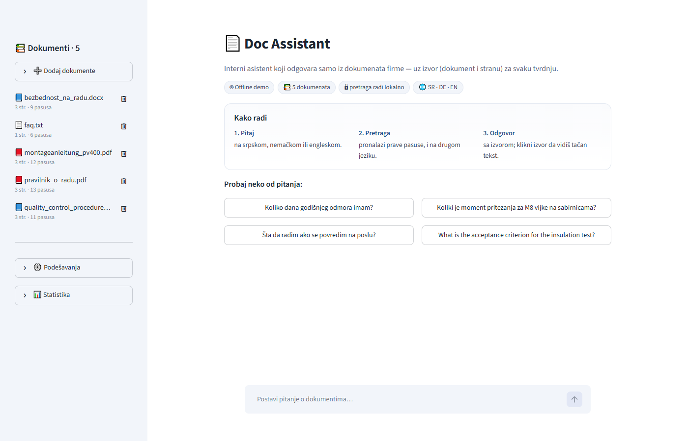
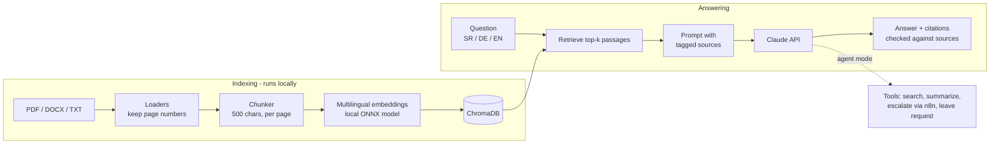

# Doc Assistant

An internal AI assistant that answers employees' questions **only from documents the company uploads**
(PDF, DOCX, TXT) — with a source citation (document + page) for every claim, and an honest
"not in the documents" when the answer isn't there.

> 🚧 Work in progress — see [`docs/PLAN.md`](docs/PLAN.md) for the roadmap.



## Planned features

- Upload company documents in Serbian, German or English; ask questions in any of them
- Answers with citations, grounded strictly in uploaded documents
- Answers by **Claude**; the provider interface also supports ChatGPT (optional)
- Agent with tools: document summary, escalation to a human, leave-request drafting
- Evaluation suite and usage monitoring (accuracy, latency, cost, user feedback)
- REST API + n8n automation example

## Tech stack

Python 3.12 · uv · Claude API · local multilingual embeddings (fastembed/ONNX) · ChromaDB · Streamlit · FastAPI · n8n · GitHub Actions

## How it works



Design decisions with alternatives and measurements: [docs/DECISIONS.md](docs/DECISIONS.md).

## Quick start

```bash
uv sync
cp .env.example .env    # add ANTHROPIC_API_KEY (the only key needed)
uv run pytest
```

## Web UI

```bash
uv run streamlit run app/streamlit_app.py
```

Upload documents (or click *Load demo documents*), pick Claude or ChatGPT in the sidebar and ask.
Every answer lists its sources; expand one to see the exact passage. Deployment notes:
[docs/DEPLOY.md](docs/DEPLOY.md).

## Command line

```bash
uv run python -m docassist.cli index data/sample_docs        # load, chunk, embed, store
uv run python -m docassist.cli search "Koliko traje godišnji odmor?"   # chunks only
uv run python -m docassist.cli ask "Koliko traje godišnji odmor?"      # answer + citations
uv run python -m docassist.cli ask "Koliki je moment za M8?" --provider openai
uv run python -m docassist.cli docs                          # list indexed documents
uv run python -m docassist.cli delete <doc_id>
```

Search runs on a local multilingual embedding model (downloaded once, ~220 MB), so documents
are never sent anywhere for indexing and a Serbian question finds a German passage. Only answers
use the Claude API. No key yet? `LLM_PROVIDER=fake` gives canned answers to try the UI.
Changing the embedding model needs `index --rebuild`.

## Agent mode

With `--agent` (CLI), `"agent": true` (API) or the *Agent mode* toggle (UI) the model decides
which tools to call: `search_documents`, `list_documents`, `summarize_document`,
`escalate_to_human` (webhook, e.g. the [n8n workflow](automations/)) and
`create_leave_request` (draft as JSON). The loop is written directly against the Claude and
OpenAI tool-use APIs, without an agent framework.

```bash
uv run python -m docassist.cli ask "Napravi mi zahtev za godišnji od 21. do 24. decembra, Ana Jovanović" --agent
```

## REST API

```bash
uv run uvicorn docassist.api:app --reload      # docs at http://localhost:8000/docs
curl -X POST localhost:8000/ask -H "Content-Type: application/json"      -d '{"question": "Koliki je moment pritezanja za M8?"}'
```

`GET /health`, `GET|POST /documents`, `DELETE /documents/{doc_id}`, `POST /ask`.
Set `API_TOKEN` to require an `X-API-Key` header.

## Evaluation & monitoring

```bash
uv run python -m docassist.eval --retrieval-only     # is the right page found? (no LLM cost)
uv run python -m docassist.eval                      # full answers, Markdown summary
uv run python -m docassist.eval --agent              # same questions through the agent
```

30 questions in [`eval/questions.yaml`](eval/questions.yaml) (Serbian, German, English, including
cross-language questions and questions the documents cannot answer). Every UI/API answer is logged
to SQLite with latency, tokens and 👍/👎 feedback; see *Usage statistics* in the sidebar or `GET /stats`.

## Demo documents

[`data/sample_docs/`](data/sample_docs/) contains documents of a **fictional** switchgear
manufacturer, Panelvolt d.o.o. (all people, phone numbers and `*.example` addresses are made up):

| File | Language | Content |
|---|---|---|
| `pravilnik_o_radu.pdf` | Serbian | Employee handbook: working hours, leave, sick leave, remote work |
| `montageanleitung_pv400.pdf` | German | Installation manual for the PV-400 cabinet system |
| `quality_control_procedure.docx` | English | Quality control procedure and routine tests |
| `bezbednost_na_radu.docx` | Serbian | Occupational health and safety rules |
| `faq.txt` | Serbian | Employee FAQ |

They are generated from the text sources in `scripts/sample_docs_src/`:

```bash
uv run python scripts/build_sample_docs.py
```

## Docker

```bash
cp .env.example .env                 # add ANTHROPIC_API_KEY
docker compose up --build            # UI http://localhost:8501 · API http://localhost:8000/docs
docker compose --profile automation up   # + n8n on http://localhost:5678
```

The image contains the embedding model, so containers start fast and index offline.
Index, logs and uploads live in Docker volumes.

## Data protection

- **Where data lives:** uploaded files (`data/uploads/`), the vector index (`data/index/`), the query
  log (`data/logs.sqlite`) and escalations/leave drafts (`data/outbox/`) stay on the server that runs
  the app. None of them is committed to git.
- **What leaves the server:** only the question and the few retrieved passages (plus tool results in
  agent mode) are sent to the Claude API to write the answer. Documents are *not* sent anywhere for
  indexing: embeddings are computed by a local model.
- **Model training:** under Anthropic's commercial API terms, inputs and outputs are not used to train
  models by default; check the current terms and retention policy before production use. The optional
  OpenAI provider sends requests with `store=False`.
- **Deleting data:** deleting a document (UI, `DELETE /documents/{id}` or `cli delete`) removes all its
  chunks and the uploaded file. The query log is a single SQLite file: delete it, or rows older than
  your retention period.
- **Access:** there is no user login yet (out of scope), so run it on an internal network; set
  `API_TOKEN` to protect the REST API. The public demo uses only fictional documents with uploads
  disabled (`ALLOW_UPLOADS=false`).
- **Prompt injection:** documents are passed as data, the model is told to ignore instructions inside
  them, citations are verified against the retrieved passages, and agent actions that matter
  (escalation, leave request) require the user's confirmation and only create drafts.

## Documentation

- [Architecture](docs/ARCHITECTURE.md)
- [Design decisions](docs/DECISIONS.md)
- [Development workflow](docs/WORKFLOW.md)
- [Deployment](docs/DEPLOY.md)
- [Automations (n8n)](automations/README.md)
