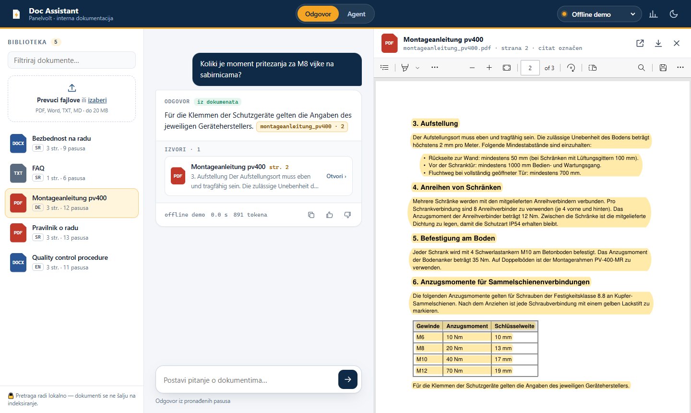
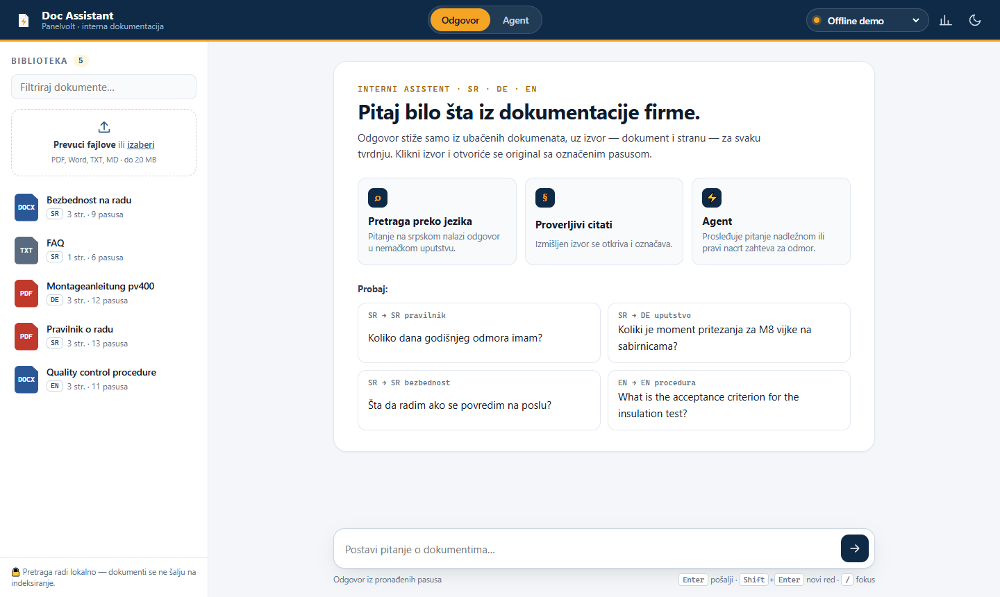
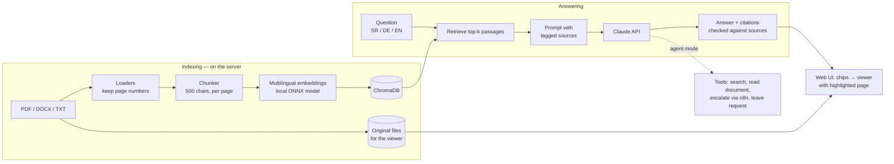

# Doc Assistant

**An internal AI assistant that answers employees' questions only from the company's own documents —
in Serbian, German or English — and cites the document and page for every claim.**
Click a citation and the original opens at that page with the passage highlighted.
When the answer is not in the documents, it says so instead of guessing.

[](https://github.com/Strvina/doc-assistant/actions/workflows/ci.yml)
· Python 3.12 · Claude API (Groq / Gemini free tiers for the demo) · FastAPI · ChromaDB · local multilingual embeddings · n8n



> The screenshots run in offline demo mode (no API key: the "answer" is the first sentence of the
> best passage). With Claude the answer is written in the language of the question.

## Why it is interesting

| | |
|---|---|
| **Cross-language search** | A Serbian question finds the answer in a German installation manual. Hybrid search: a local multilingual embedding model plus BM25 keywords for exact words and codes; chunks follow document sections, so a table stays with its heading — measured: every key fact reaches the model for **27/27** evaluation questions. |
| **Verifiable citations** | Every claim cites `[document, page]`. Citations are checked against the passages the model actually received; a made-up source is flagged in the UI. |
| **Highlighted originals** | Sources open in a built-in viewer: PDFs on the right page with the cited blocks highlighted, Word/text documents rendered as pages with the passage marked. Every document can be viewed whole or downloaded. |
| **Agent with tools** | Native Claude tool use, no framework: search, read a whole document, escalate an unanswered question to a person (n8n → e-mail), draft a leave request. |
| **Measured, monitored** | 30-question evaluation set and runner; every answer logged with latency, tokens, cost and 👍/👎; a dashboard lists the **gaps in the documentation** (questions the documents could not answer). |
| **Reads scans and images** | Scanned PDFs, screenshots pasted into PDFs and uploaded photos (PNG/JPG/TIFF) are read with local OCR (Tesseract; Serbian Latin and Cyrillic, German, English). The viewer highlights the cited passage on the scan too — measured: 100 % correct answers with the demo PDFs replaced by image-only scans. |
| **Saved conversations** | Every question is saved in a conversation you can reopen (answers shown exactly as they were) or delete; a question can be stopped while it is being answered and comes back into the input to be corrected. Conversations belong to the browser session — visitors of the public demo never see each other's. |
| **Privacy-minded** | Documents are indexed locally; only the question and a few retrieved passages go to the model. Demo mode with upload lock and per-session / per-IP limits. |



## How it works



Every design decision, with alternatives and measurements: [docs/DECISIONS.md](docs/DECISIONS.md).
Code map: [docs/ARCHITECTURE.md](docs/ARCHITECTURE.md).

## Run it

```bash
uv sync
cp .env.example .env                       # add ANTHROPIC_API_KEY, or free GROQ_API_KEY /
                                           # GEMINI_API_KEY with LLM_PROVIDER=groq (ADR-022)
uv run uvicorn docassist.api:app --reload  # → http://localhost:8000
```

Open the page, click **Učitaj demo dokumente** (load demo documents) and ask, e.g.
*„Koliki je moment pritezanja za M8 vijke na sabirnicama?“* — the answer cites the German manual,
page 2. No key yet? `LLM_PROVIDER=fake` in `.env` runs everything offline with canned answers.

With Docker: `docker compose up --build` → <http://localhost:8000>
(`--profile automation` adds n8n on port 5678).

## Command line

```bash
uv run python -m docassist.cli index data/sample_docs           # load, chunk, embed, store
uv run python -m docassist.cli ask "Koliko traje godišnji odmor?"  # answer + citations
uv run python -m docassist.cli ask "Prosledi HR-u: ko odobrava bonus?" --agent
uv run python -m docassist.cli search "Anzugsmoment M8"           # retrieved passages only
uv run python -m docassist.cli docs                              # list · delete <doc_id>
```

## REST API

The same app serves the API (OpenAPI docs at `/docs`):
`POST /ask` (`"agent": true` for tools) · `GET|POST /documents` · `DELETE /documents/{id}` ·
`GET /documents/{id}/view?page=&chunk=` (highlighted original) · `GET /documents/{id}/file` ·
`POST /feedback` · `GET /insights` · `GET /health`.

```bash
curl -X POST localhost:8000/ask -H "Content-Type: application/json" \
     -d '{"question": "Koliki je moment pritezanja za M8?"}'
```

Without `API_TOKEN` the app is open (internal network). With it, integrations send `X-API-Key`
and browsers use a session cookie issued by the web UI.

## Evaluation

```bash
uv run python -m docassist.eval --retrieval-only   # is the right page retrieved? (no LLM cost)
uv run python -m docassist.eval                    # full answers: citations, facts, "not found"
uv run python -m docassist.eval --agent            # the same questions through the agent
```

[`eval/questions.yaml`](eval/questions.yaml): 30 questions in three languages, including
cross-language questions and questions the documents cannot answer. Metrics: page and document
citation accuracy, key-fact recall, correct "not found", made-up citations, latency, tokens, cost.

| Retrieval (27 answerable questions) | right page in top 5 | on top |
|---|---|---|
| keyword hashing (baseline) | 56 % | — |
| local multilingual MiniLM, 800-char chunks | 89 % | 74 % |
| local multilingual MiniLM, 500-char chunks | 100 % | 85 % |

| Answers (30 questions, Groq `openai/gpt-oss-120b`, free tier) | Correct | Made-up citations |
|---|---|---|
| embeddings only, fixed chunks | 93 % | 0 |
| **hybrid search + section chunks** (ADR-023) | **100 %** | **0** |

A small set written by the author, so treat these numbers as a sanity check, not a benchmark.
Details, the agent run and what did not work (rank fusion): [docs/EVAL_RESULTS.md](docs/EVAL_RESULTS.md).

## Automation (n8n)

Escalations from the agent go to an n8n webhook that e-mails the responsible person
([workflow export](automations/escalation_workflow.json)). One command starts n8n and a local
test inbox (Mailpit) and installs the workflow: `uv run python scripts/setup_n8n.py`.
See [automations/README.md](automations/README.md).

## Demo documents

[`data/sample_docs/`](data/sample_docs/) holds documents of a **fictional** switchgear manufacturer,
Panelvolt d.o.o. (all people, phone numbers and `*.example` addresses are made up):

| File | Language | Content |
|---|---|---|
| `pravilnik_o_radu.pdf` | Serbian | Employee handbook: working hours, leave, sick leave, remote work |
| `montageanleitung_pv400.pdf` | German | Installation manual for the PV-400 cabinet system |
| `quality_control_procedure.docx` | English | Quality control procedure and routine tests |
| `bezbednost_na_radu.docx` | Serbian | Occupational health and safety rules |
| `faq.txt` | Serbian | Employee FAQ |

Generated from `scripts/sample_docs_src/` by `uv run python scripts/build_sample_docs.py`.

## Data protection

- **Where data lives:** the vector index, the original files, the query log and escalation/leave
  drafts stay on the server running the app (`data/`, or Docker volumes). None of it is in git.
- **What leaves the server:** only the question and the few retrieved passages (plus tool results in
  agent mode) go to the Claude API. Documents are not sent anywhere for indexing — embeddings are
  computed by a local model.
- **Model training:** under Anthropic's commercial API terms, inputs and outputs are not used for
  training by default; check the current terms and retention policy before production use.
  The public demo runs on **free tiers (Groq, Gemini)**; their terms may allow using content to
  improve their services — fine for the fictional demo documents, not for real company documents
  (ADR-021, ADR-022).
- **Deleting data:** deleting a document (UI, API or CLI) removes its chunks and the stored original.
  Deleting a conversation removes it and its answers from the server. The query log (with the
  saved conversations) is one SQLite file: delete it, or rows older than your retention period.
- **Access:** no user accounts yet (out of scope) — run it on an internal network, or set
  `API_TOKEN`. The public demo uses fictional documents, uploads disabled (`ALLOW_UPLOADS=false`)
  and per-session / per-IP question limits.
- **Prompt injection:** documents are passed as data and the model is told to ignore instructions in
  them; citations are verified; agent actions that matter need the user's confirmation and only
  create drafts.

## Development

`uv run ruff check . && uv run ruff format --check . && uv run pytest` — CI runs the same on every
pull request; tests use fake models and never call real APIs.
Workflow: [docs/WORKFLOW.md](docs/WORKFLOW.md) · deployment: [docs/DEPLOY.md](docs/DEPLOY.md) ·
roadmap: [docs/PLAN.md](docs/PLAN.md).
